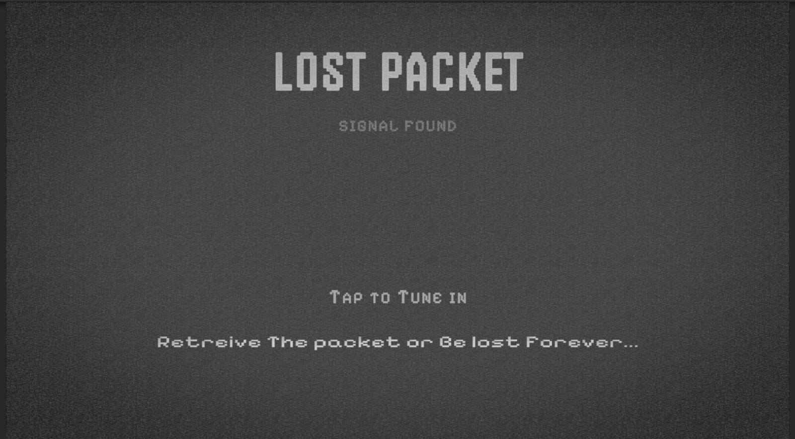
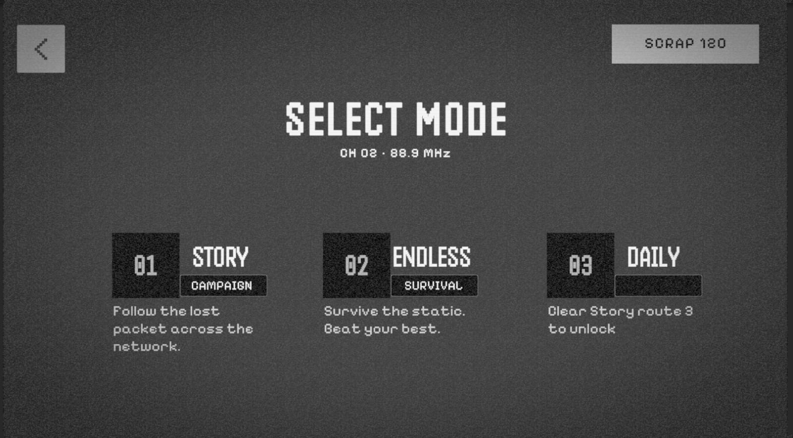
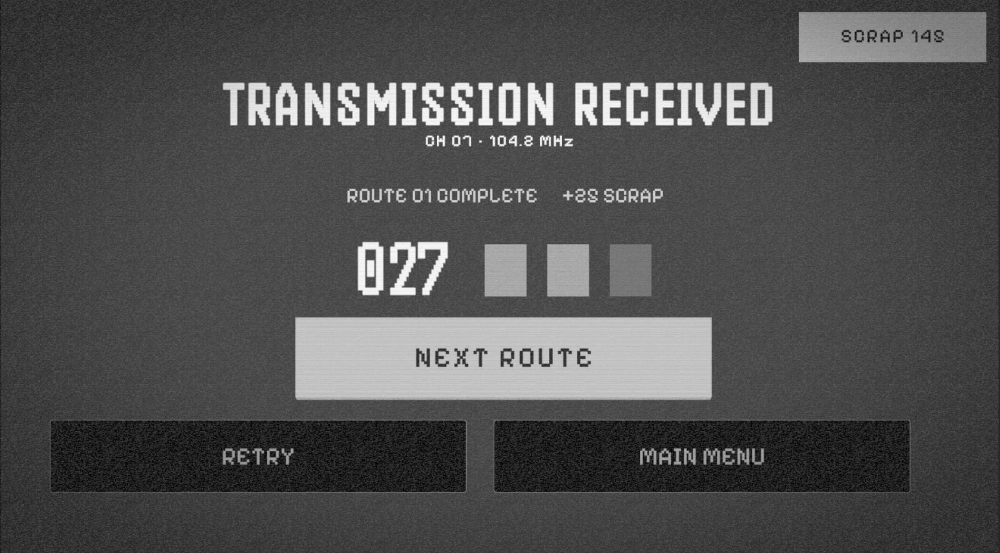
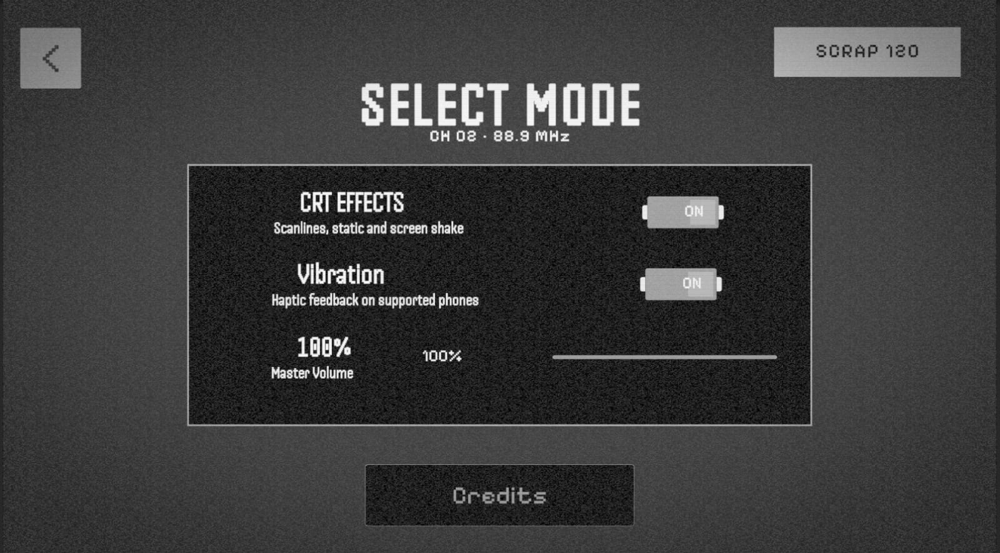

# CS464 LAB 07 · Ruhma Binte Asad · BSCS25107

**Demo Video:** [Drive link](https://drive.google.com/file/d/18Vv3i7vCrJSKbdyxA6DjKdbTuX8gmP_w/view?usp=sharing)

## SCREEN NO. 01 
- **Screen:** Title
- **Principles:** 
- **Techniques:**
- **The Tweens/Ease Curves:** 
- *Reason:* 

nothing changed ^u^ 

## SCREEN NO. 02 
- **Screen:** Main Menu 
- **Principles:** 
- **Techniques:**
- **The Tweens/Ease Curves:** 
- *Reason:* 

nothing changed ^u^ 

## SCREEN NO. 03
- **Screen:** Mode Select
- **Principles:** 
- **Techniques:**
- **The Tweens/Ease Curves:** 
- *Reason:* 

nothing changed ^u^ 

## SCREEN NO. 04
- **Screen:** Level Select
- **Principles:** 
- **Techniques:**
- **The Tweens/Ease Curves:** 
- *Reason:* 

nothing changed ^u^ 

## SCREEN NO. 05
- **Screen:** Loadout
- **Principles:** 
- **Techniques:**
- **The Tweens/Ease Curves:** 
- *Reason:* 

nothing changed ^u^ 

## SCREEN NO. 06
- **Screen:** Results
- **Principles:** 
- **Techniques:**
- **The Tweens/Ease Curves:** 
- *Reason:* 

nothing changed ^u^ 

## SCREEN NO. 07
- **Screen:** Pause
- **Principles:** 
- **Techniques:**
- **The Tweens/Ease Curves:** 
- *Reason:* 
nothing changed ^u^ 

nothing changed ^u^ 

## SCREEN NO. 08 
- **Screen:** Shop
- **Principles:** 
- **Techniques:**
- **The Tweens/Ease Curves:** 
- *Reason:* 

nothing changed ^u^ 

## SCREEN NO. 09
- **Screen:** Settings
- **Principles:** 
- **Techniques:**
- **The Tweens/Ease Curves:** 
- *Reason:* 

nothing changed ^u^ 

## SCREEN NO. 10
- **Screen:** Credits
- **Principles and Techniques:**
| :--- | :--- |
| **Hierarchy** | Game title, section headings, and body text are differentiated using distinct font sizes, typefaces, and opacity levels. |
| **Gestalt (Proximity)** | Each heading and its corresponding text are grouped into distinct sections separated by clear spacing. |
| **Common Region** | Scrolling text is clipped by a UI mask so it remains contained and never overlaps with the main heading. |
| **No Dead Ends** | Every screen includes an accessible Back button to ensure clear navigation. |
| **To The Point** | The credits screen strictly displays essential contributor information without unnecessary clutter. |
- **The Tweens and Ease Curves**
| Tween | Duration / Speed | Ease | Reason |
| :--- | :--- | :--- | :--- |
| **Credit Scroll** | Till the text ends at speed 110 *(changeable)* | **Linear** | Constant speed is easiest to read |
| **Endcard Fade-In** | ~0.6s | **OutCubic** | Clear signal that the list has finished |
| **Screen Change** | 0.4s in, 0.25s out | **OutCubic / InCubic** | Consistent transition language |

nothing changed ^u^ 

