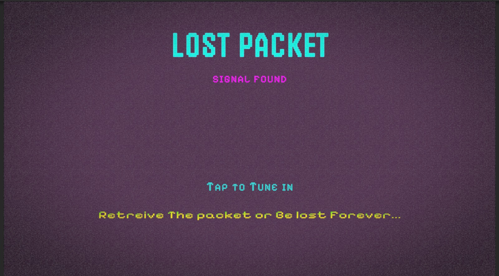
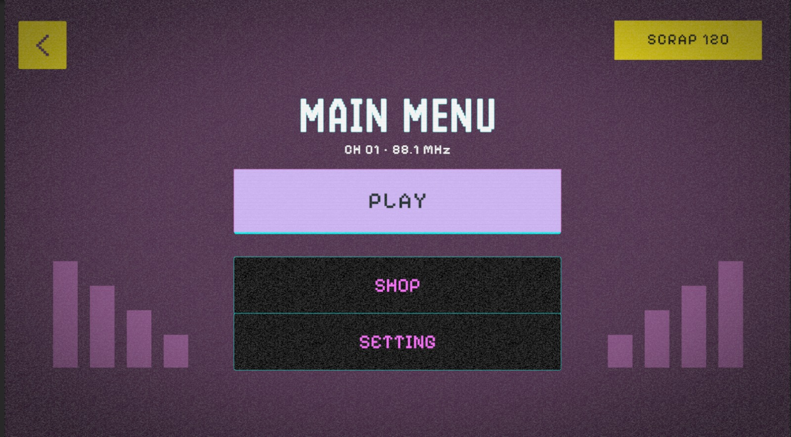
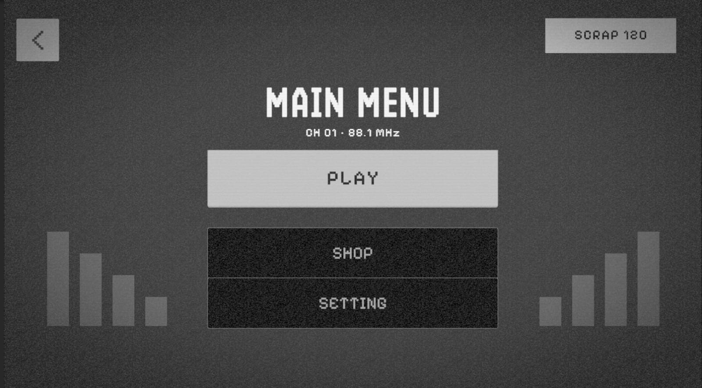
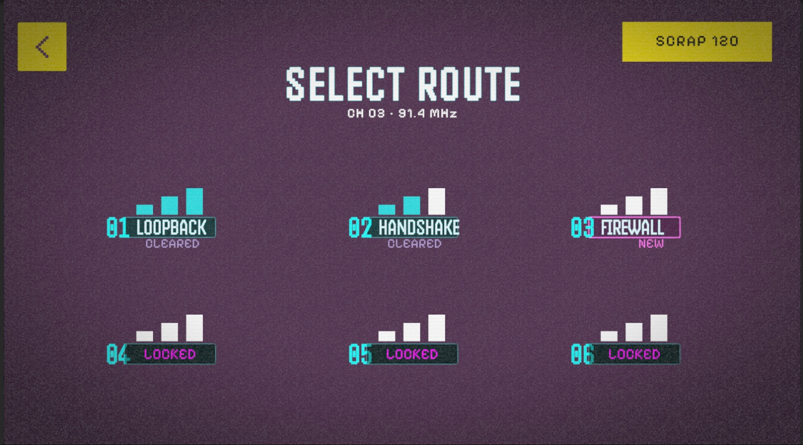
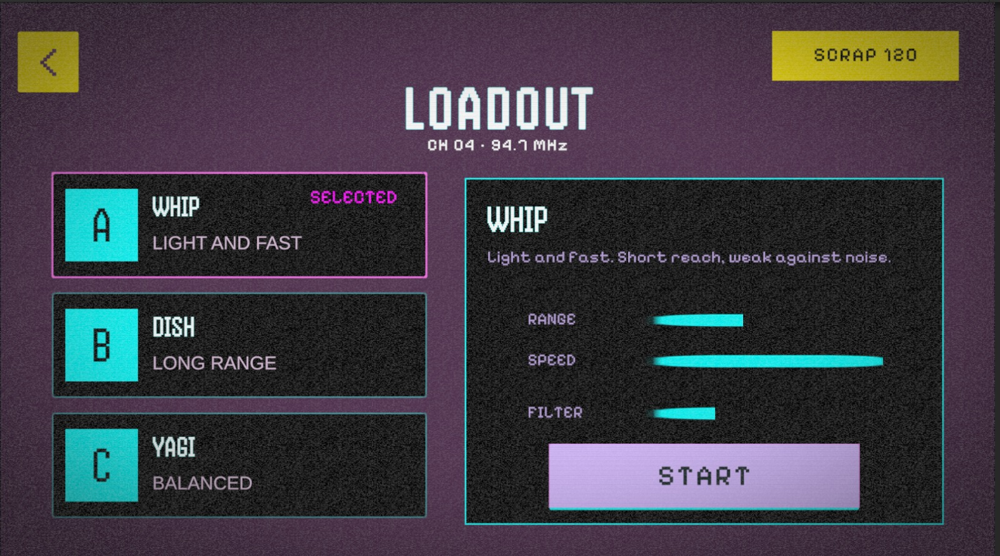
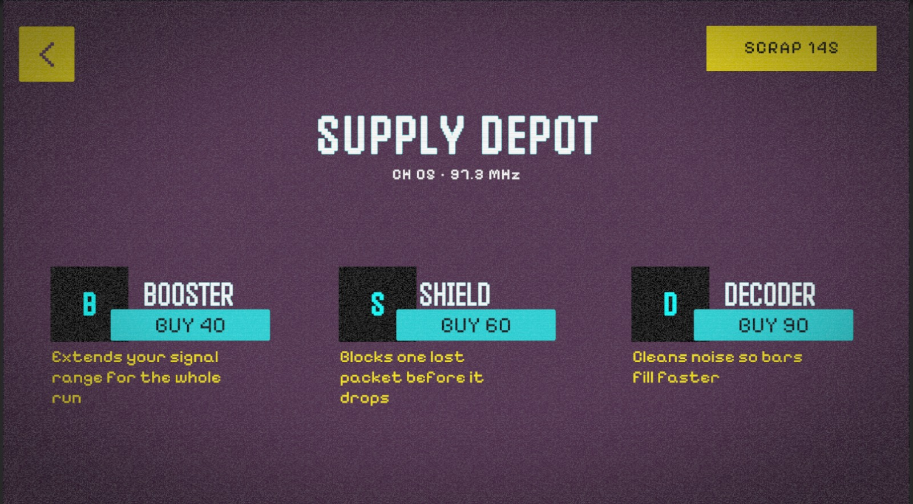

# CS464 LAB 07 · Ruhma Binte Asad · BSCS25107

**Demo Video:** [Google Play link](...)

## SCREEN NO. 01 
- **Screen:** Title
- **Principles:** 
- **Techniques:**
- **The Tweens/Ease Curves:** 
- *Reason:* 

## SCREEN NO. 02 
- **Screen:** Main Menu 
- **Principles:** 
- **Techniques:**
- **The Tweens/Ease Curves:** 
- *Reason:* 

## SCREEN NO. 03
- **Screen:** Mode Select
- **Principles:** 
- **Techniques:**
- **The Tweens/Ease Curves:** 
- *Reason:* 

## SCREEN NO. 04
- **Screen:** Level Select
- **Principles:** 
- **Techniques:**
- **The Tweens/Ease Curves:** 
- *Reason:* 

## SCREEN NO. 05
- **Screen:** Loadout
- **Principles:** 
- **Techniques:**
- **The Tweens/Ease Curves:** 
- *Reason:* 

## SCREEN NO. 06
- **Screen:** Results
- **Principles:** 
- **Techniques:**
- **The Tweens/Ease Curves:** 
- *Reason:* 

## SCREEN NO. 07
- **Screen:** Pause
- **Principles:** 
- **Techniques:**
- **The Tweens/Ease Curves:** 
- *Reason:* 

## SCREEN NO. 08 
- **Screen:** Shop
- **Principles:** 
- **Techniques:**
- **The Tweens/Ease Curves:** 
- *Reason:* 

## SCREEN NO. 09
- **Screen:** Settings
- **Principles:** 
- **Techniques:**
- **The Tweens/Ease Curves:** 
- *Reason:* 

## SCREEN NO. 10
- **Screen:** Credits
- **Principles:** 
- **Techniques:**
- **The Tweens/Ease Curves:** 
- *Reason:* 

