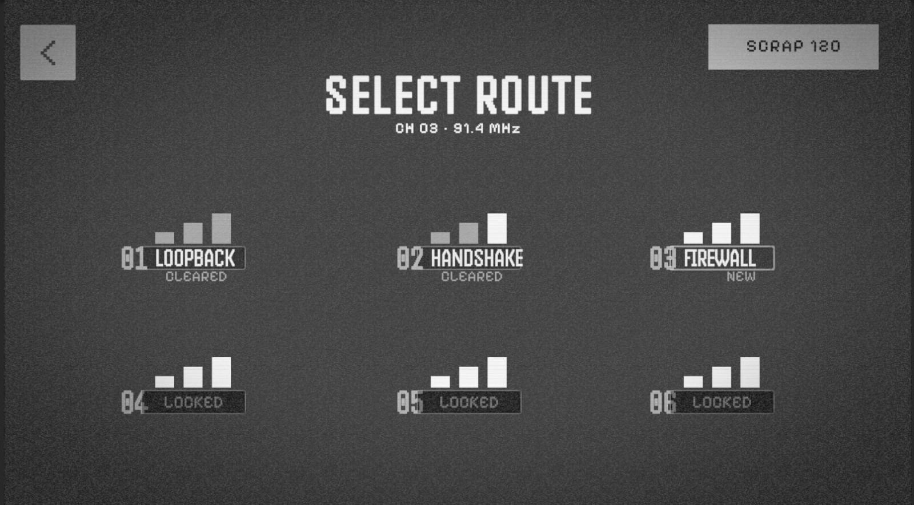
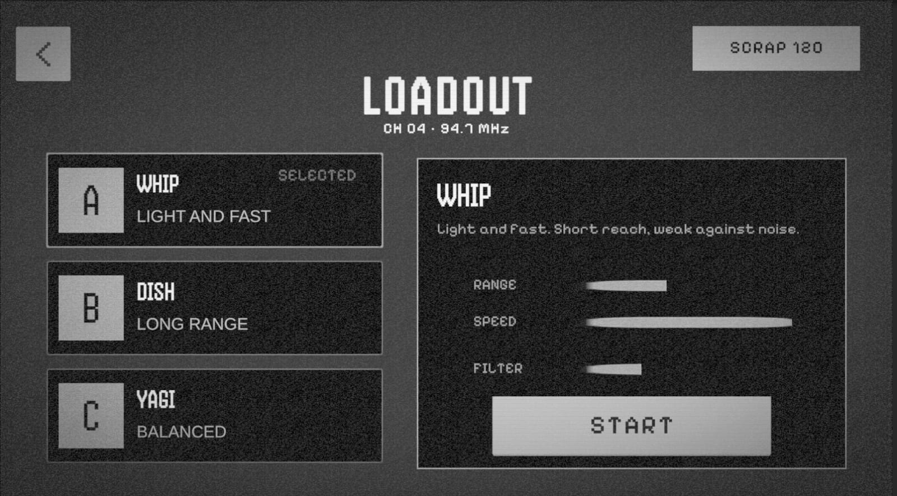
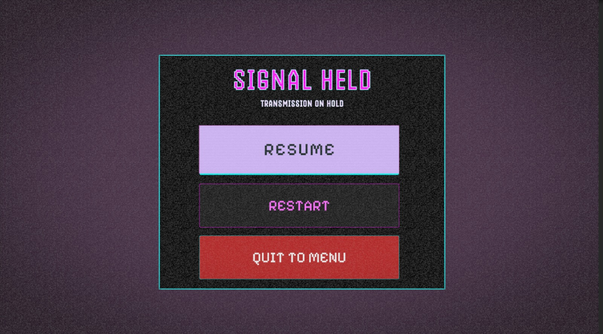
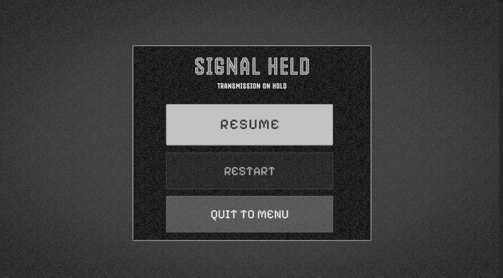
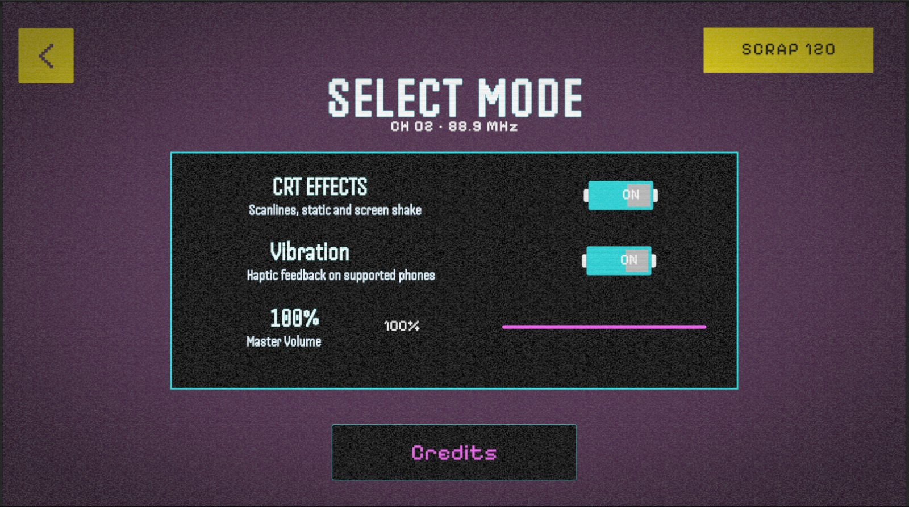
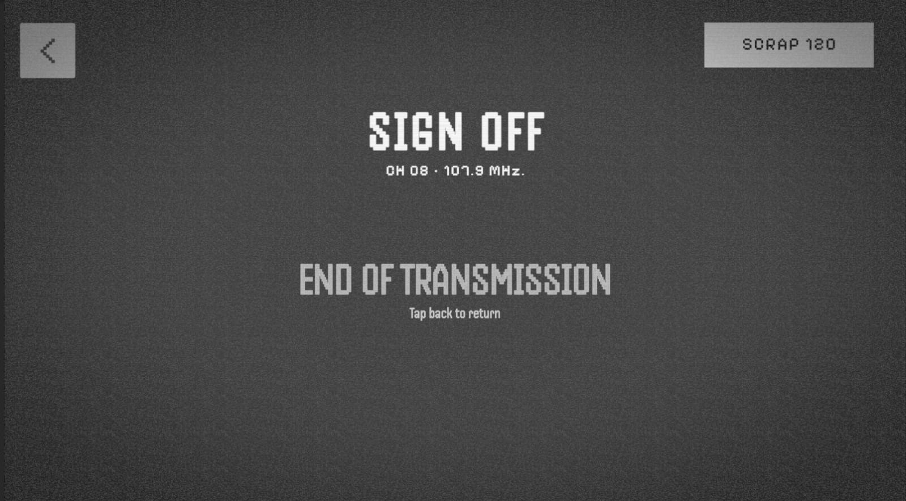

# CS464 LAB 07 · Ruhma Binte Asad · BSCS25107

**Demo Video:** [Google Play link](...)

## SCREEN NO. 01 
- **Screen:** Title
- **Principles:** 
- **Techniques:**
- **The Tweens/Ease Curves:** 
- *Reason:* 

## SCREEN NO. 02 
- **Screen:** Main Menu 
- **Principles:** 
- **Techniques:**
- **The Tweens/Ease Curves:** 
- *Reason:* 

## SCREEN NO. 03
- **Screen:** Mode Select
- **Principles:** 
- **Techniques:**
- **The Tweens/Ease Curves:** 
- *Reason:* 

## SCREEN NO. 04
- **Screen:** Level Select
- **Principles:** 
- **Techniques:**
- **The Tweens/Ease Curves:** 
- *Reason:* 

## SCREEN NO. 05
- **Screen:** Loadout
- **Principles:** 
- **Techniques:**
- **The Tweens/Ease Curves:** 
- *Reason:* 

## SCREEN NO. 06
- **Screen:** Results
- **Principles:** 
- **Techniques:**
- **The Tweens/Ease Curves:** 
- *Reason:* 

## SCREEN NO. 07
- **Screen:** Pause
- **Principles:** 
- **Techniques:**
- **The Tweens/Ease Curves:** 
- *Reason:* 

## SCREEN NO. 08 
- **Screen:** Shop
- **Principles:** 
- **Techniques:**
- **The Tweens/Ease Curves:** 
- *Reason:* 

## SCREEN NO. 09
- **Screen:** Settings
- **Principles:** 
- **Techniques:**
- **The Tweens/Ease Curves:** 
- *Reason:* 

## SCREEN NO. 10
- **Screen:** Credits
- **Principles and Techniques:**
  |Hierarchy|Game name, Section headings, Body texts with different size, fonts and opacity|
  |Getalt|Each heading/texts has there own sections with spaces among each|
  |Common Region| The scrolling text is clipped by a mask so that it never overlaps with the main heading.|
  |No Dead End| Back button every screen|
  |To The Point|Only credits are listed, only showing what is needed.|
- **The Tweens and Ease Curves:**
  |Tween|Ease|reason|
  |Credit Scroll till the texts ends at speed 110(changeable)|Linear|Constant speed is easiest to read|
  |Endcard fade in for about 0.6s|OutCubic|Clear signal that the list has finished|
  |Screen Change|0.4 s in, 0.25 s out|OutCubic / InCubic|Consistent transition language|

