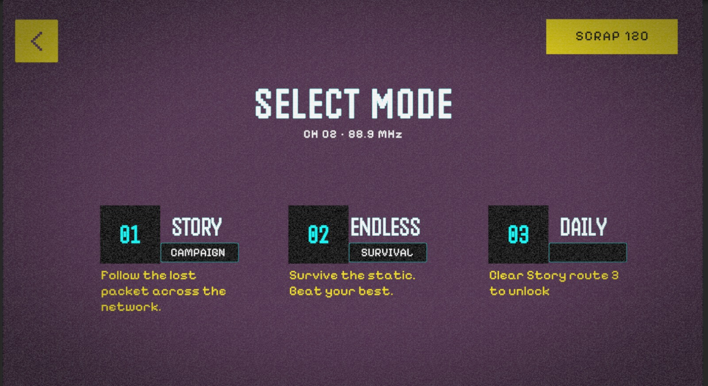
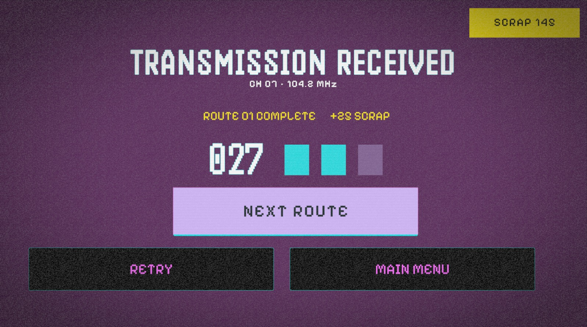
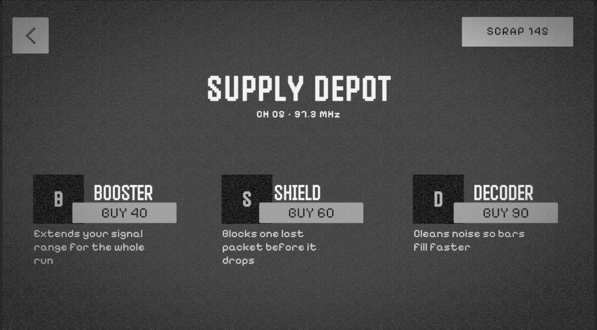
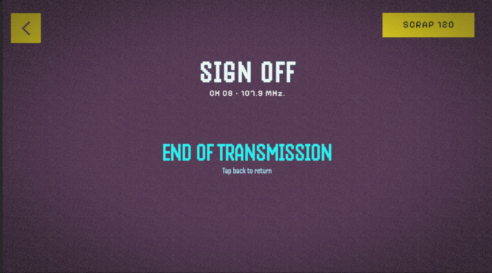

# CS464 LAB 07 · Ruhma Binte Asad · BSCS25107

**Demo Video:** [Drive link](https://drive.google.com/file/d/18Vv3i7vCrJSKbdyxA6DjKdbTuX8gmP_w/view?usp=sharing)

## SCREEN NO. 01 
- **Screen:** Title
### Principles and Techniques:
| Principal | How and Where |
| :--- | :--- |
| **Hierarchy** |the logo is the largest and brightest element, the status and tagline are smaller, the prompt sits alone near the bottom |
| **Colour semantics** |the status starts green and switches to pink , telling the game's story through stat |
| **Affordance** |The whole screen is a tap target, and the pulsing prompt tells the player what to do |
| **Responsive layout** |Logo anchored to the top, prompt to the bottom, content inside the Safe Area|
### The Tweens and Ease Curves
| Tween | Duration / Speed | Ease | Reason |
| :--- | :--- | :--- | :--- |
| **Status fade in** |0.3s |OutCubbic|Establishes the "no signal" state first |
| **Signal-lock static burst** |0.3 s | 	OutCubic | Marks the moment the signal is found |
| **Logo slide and fade** |0.6s | 	OutCubic|Calm, technical arrival, no bounc |
| **Tagline fade** |0.4s | OutCubic | Reads after the logo |
| **Prompt pulse** |0.5 Hz | - | Idle invitation to tap, slow enough to avoid flashing |
### Colour and Black&White Screenshots 

nothing changed ^u^ 

## SCREEN NO. 02 
- **Screen:** Main Menu 
### Principles and Techniques:
| Principal | How and Where |
| :--- | :--- |
| **Hierarchy** |Oonly PLAY is a filled cyan button and it is the largest; Shop and Settings are outlined|
| **Proximity** |the three buttons form one stack with equal spacing; the header is a separate group|
| **Consistency** |Back button top-left, currency top-right, the same as every other screen |
| **The signal-bar graphics** |Flank the buttons, making the idle screen feel alive and reinforcing the radio theme|
| **Colour semantics** |Cyan for action, yellow for the currency. |
### The Tweens and Ease Curves
| Tween | Duration / Speed | Ease | Reason |
| :--- | :--- | :--- | :--- |
| **Stagger in** |0.35 s, 0.05 s apart|OutBack|Order shows reading priority, small bounce adds life |
| **Button press / release** |0.08 s / 0.25 s | OutBack |Immediate feedback, then a springy release |
| **Signal bars fill** |	2.8 s loop | OutCubic |Idle state shows "searching" and connects to the theme |
| **Screen change** |0.4 s in, 0.25 s out, static burst 0.35 s | OutBack | Consistent transition language |
### Colour and Black&White Screenshots 

nothing changed ^u^ 

## SCREEN NO. 03
- **Screen:** Mode Select
### Principles and Techniques:
| Principal | How and Where |
| :--- | :--- |
| **Hierarchy** | Title larger than description, description larger than tag |
| **Fitts's law** |Three large cards across the full width |
| **Affordance** | The locked Daily card is dimmed, carries a label, and the reason |
| **Colour-blind rule** | The locked state is shown by dimming, a label and a shake, not by hue|
### The Tweens and Ease Curves
| Tween | Duration / Speed | Ease | Reason |
| :--- | :--- | :--- | :--- |
| **Staggered IN** | 0.35 s, 0.05 s apart| OutBack|Entering from the right signals forward movement |
| **Locked card shake** | 0.4 s | OutCubic |A horizontal shake is a universal "no", and it settles quickly |
| **Press feedback** | 0.25 s | OutCubic | Standard button feedback |
### Colour and Black&White Screenshots 

nothing changed ^u^ 

## SCREEN NO. 04
- **Screen:** Level Select
### Principles and Techniques:
| Principal | How and Where |
| :--- | :--- |
| **States** |Three states per card: Cleard whith tag and earned signal bars, Current with pink thick outline and tag and Locked with dim overlay and label |
| **Proximity** |Common region (each card groups number, name and bars), similarity (six identical cards), alignment (shared left edge), proximity (equal gaps) |
| **Fitts's law** |the primary (Next Route) is on the right where it is in middle in landscape |
| **Show Required Stuff** |six routes in a 3 x 2 grid, no paging|
| **Colour-blind rule** | state is carried by text, outline thickness and bar count as well as colour. |
### The Tweens and Ease Curves
| Tween | Duration / Speed | Ease | Reason |
| :--- | :--- | :--- | :--- |
| **Cards stagger in** |0.35 s, 0.05 s apart|OutBack|	Reading order and a lively entrance |
| **Press feedback** |0.08 s / 0.25 s | OutBack | Standard button feedback |
### Colour and Black&White Screenshots 

nothing changed ^u^ 

## SCREEN NO. 05
- **Screen:** Loadout
### Principles and Techniques:
| Principal | How and Where |
| :--- | :--- |
| **Hierarchy** | Item name is the largest text in the detail panel, stat labels are small, START is the single filled button|
| **Common Region** |Three item cards on the left, a detail panel with stats on the right |
| **Fitts's law** |Wide item cards and a large START button|
| **Selected state** |Pink outline, thicker border and a SELECTED label |
| **Quantity at a glance** |Stat bars (Range, Speed, Filter) use filled images, so length carries the data|
### The Tweens and Ease Curves
| Tween | Duration / Speed | Ease | Reason |
| :--- | :--- | :--- | :--- |
| **Stat bars change** |0.35 s |OutCubic |Moves from the old value to the new one, so the difference is felt |
| **Cards and panel stagger in** | 0.35 s, 0.05 s apart | OutBack |	Reading order |
| **Press feedback** |0.08 s / 0.25 s |OutCubic / OutBack | Standard button feedback |
### Colour and Black&White Screenshots 

nothing changed ^u^ 

## SCREEN NO. 06
- **Screen:** Results
### Principles and Techniques:
| Principal | How and Where |
| :--- | :--- |
| **Hierarchy** | the score is the largest and most central element. Everything else is secondary |
| **Proximity** | score, bars and reward form one group, these three buttons form another along the bottom |
| **Fitts's law** |the primary (Next Route) is on the right where it is in middle in landscape |
| **Colour semantics** | cyan for earned signal, yellow for the reward. |
| **Colour-blind rule** | the rating is read from the number and height of the bars, not only their colour |
### The Tweens and Ease Curves
| Tween | Duration / Speed | Ease | Reason |
| :--- | :--- | :--- | :--- |
| **Score counts up** | 1.2 s | OutExpo |Fast start shows the size of the score, slow finish builds anticipation |
| **Bars pop in one by one** | 0.3 s each, 0.15 s apart | OutCubic |The reward arrives piece by piece |
| **Currency count-up** | 0.5 s | OutCubic | Shows the reward being addede |
| **Items stagger in** | 0.35 s, 0.05 s apart | OutBack | Reading order |
### Colour and Black&White Screenshots 

nothing changed ^u^ 

## SCREEN NO. 07
- **Screen:** Pause
### Principles and Techniques:
| Principal | How and Where |
| :--- | :--- |
| **Figure and ground** |A dark dim layer pushes the game back and brings the box forward |
| **Common region** | Title and three buttons share one bo |
| **Hierarchy** |RESUME is the tmost visible, since it is the most common action |
| **Consistency** | the Pause button sits in the same top-left place as Back on other screens|
| **Colour-blind rule** | Quit is red, but it is also labelled and placed last|
| **Pause rules** | Time.timeScale = 0, a static IsPaused flag, AudioListener.pause, and the time scale is restored whenever the Pause screen closes, so Resume, Restart and Quit all unfreeze the game.|

### The Tweens and Ease Curves
| Tween | Duration / Speed | Ease | Reason |
| :--- | :--- | :--- | :--- |
| **Box rises from below** | 0.3 s| OutBack |	It appears over the game rather than replacing it|
| **Exit** | 0.25 s | 	InCubic |Fast exit so the game resumes quickly|
| **Press feedback** | 0.25 s |OutCubic / OutBack |Works while paused because it uses unscaled time|
### Colour and Black&White Screenshots 

nothing changed ^u^ 

## SCREEN NO. 08 
- **Screen:** Shop

### Principles and Techniques:
| Principal | How and Where |
| :--- | :--- |
| **Hierarchy** | The cyan BUY button is the only filled element on each card.|
| **Grouping** |Each card holds badge, title, description and its own BUY button |
| **Three button states** |Buy 40(affordable), NEED 10 (not enough scrap), OWNED (already bought) |
| **Colour-blind rul** | Affordability is shown by text and fill value, not by hue alone.|
| **Consistency** | The currency counter is in the same place on every screen and always shows the same value|
### The Tweens and Ease Curves
| Tween | Duration / Speed | Ease | Reason |
| :--- | :--- | :--- | :--- |
| **Currency counts down** | 0.5 s | OutCubic |A shrinking number makes the cost felt |
| **Purchased card stamp** | 0.35 s | 	OutBack | Confirms the purchase |
| **Denial shake when too poor** | 0.4 s | OutCubic decay |Clear visual "cannot do that" |
| **Cards stagger in** | 0.35 s, 0.05 s apart | OutBack |Reading order |
### Colour and Black&White Screenshots 

nothing changed ^u^ 

## SCREEN NO. 09
- **Screen:** Settings
### Principles and Techniques:
| Principal | How and Where |
| :--- | :--- |
| **Hierarchy** |Setting name larger than its hint|
| **Alignment** |Labels share a left column, controls share a right column. |
| **Fitts's law** |The switch tap area is 240 x 120 even though the visible track is smaller; the slider is 420 x 80|
| **Accessibility** |The CRT Effects toggle turns off scanlines, static and screen shake for players who find them uncomfortable |
| **Colour-blind rule** | ttoggle state is shown by colour, knob position and an ON/OFF label |
### The Tweens and Ease Curves
| Tween | Duration / Speed | Ease | Reason |
| :--- | :--- | :--- | :--- |
| **Toggle knob slide and track colour** | 0.2 s | OutCubic |Fast and visible response to a binary choice|
| **Items stagger in** | 0.35 s, 0.05 s apart | OutBack |Reading order|
| **Static burst on screen change** |0.35 s | OutCubic | Can be disabled by the CRT Effects setting|
### Colour and Black&White Screenshots 

nothing changed ^u^ 

## SCREEN NO. 10
- **Screen:** Credits
### Principles and Techniques:
| Principal | How and Where |
| :--- | :--- |
| **Hierarchy** | Game title, section headings, and body text are differentiated using distinct font sizes, typefaces, and opacity levels. |
| **Proximity** | Each heading and its corresponding text are grouped into distinct sections separated by clear spacing. |
| **Common Region** | Scrolling text is clipped by a UI mask so it remains contained and never overlaps with the main heading. |
| **No Dead Ends** | Every screen includes an accessible Back button to ensure clear navigation. |
| **To The Point** | The credits screen strictly displays essential contributor information without unnecessary clutter. |
### The Tweens and Ease Curves
| Tween | Duration / Speed | Ease | Reason |
| :--- | :--- | :--- | :--- |
| **Credit Scroll** | Till the text ends at speed 110 *(changeable)* | Linear | Constant speed is easiest to read |
| **Endcard Fade-In** | ~0.6s | OutCubic | Clear signal that the list has finished |
| **Screen Change** | 0.4s in, 0.25s out | OutCubic / InCubic | Consistent transition language |
### Colour and Black&White Screenshots 

nothing changed ^u^ 

